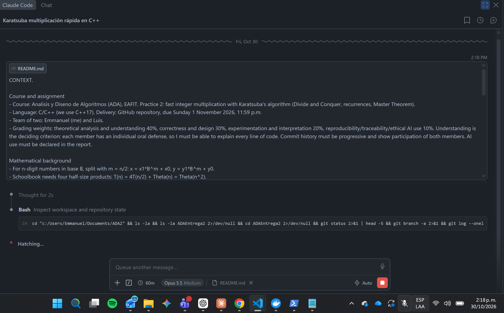
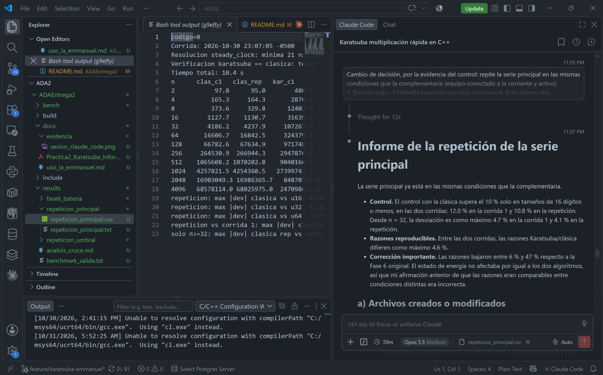

# Uso de inteligencia artificial

Notas para la declaración de uso de IA del informe. Cubren mi parte de la
práctica: Karatsuba, relleno a potencia de 2, caso base, validación, conteo de
productos, medición de tiempos, punto de cruce, gráficas y documentación. Se
unificarán con las notas de Luis.

## Herramientas

- **Claude (claude.ai):** lo usé para planear el trabajo y redactar las
  instrucciones por fases que luego di a Claude Code. Opus 5.5 Oct 30-31.
- **Claude Code (extensión de VS Code, con WSL Ubuntu-22.04):** lo usé para
  implementar, probar, medir y analizar, siguiendo esas instrucciones fase por
  fase. Al final de cada fase se detenía y entregaba un informe fijo; solo
  continuaba cuando yo lo indicaba. Opus 5.5.

## Qué verifiqué yo

- Revisé el informe de cada fase antes de aceptarla: archivos modificados,
  comandos con sus salidas reales y notas para la defensa. 
- Tomé estas decisiones de diseño y de método:
  - el relleno a potencia de 2 se hace solo en el envoltorio público. La IA
    había sugerido al principio rellenar en cada nivel de la recursión;
    descarté esa sugerencia porque haría que la rama de P3 no se reduzca;
  - m = floor(L/2) sobre la longitud mayor;
  - el umbral 1 se mantiene como resultado principal, y añadí una serie
    complementaria con umbrales 16, 32 y 64 para localizar el cruce;
  - repetí la serie complementaria cuando una suspensión del equipo
    contaminó la primera corrida;
  - repetí la serie principal cuando el control con la clásica mostró que se
    había medido en otro estado de energía;
  - el control con la clásica se aplica desde n ≥ 32; en tamaños menores el
    ruido es inherente.
- Hice todos los commits de mi rama. 
- Corregí, o pedí corregir, afirmaciones de la IA que los datos desmintieron.
  Por ejemplo, la IA supuso que la razón Karatsuba/clásica era comparable
  entre corridas en distintos estados de energía, y la repetición mostró que
  no lo es.

## Limitaciones

- Las cifras de tiempo dependen del entorno: CPU, WSL2, estado de energía y
  carga del sistema. Solo son comparables las series medidas en las mismas
  condiciones (`results/entorno.txt`).
- El cruce con umbral 1 es una extrapolación con supuestos, no una medición,
  y es sensible a la diferencia de pendientes.
- El modelo de costo por umbral (hojas frente a nodos internos) es
  cualitativo: no se ajustaron sus constantes a los datos.
- El estado de energía se declara manualmente; no se detecta de forma
  automática.

## Evidencia

Inicio de la sesión de Claude Code en VS Code (30 de octubre de 2026, 2:18 p. m.):
el mensaje de contexto con el que empecé el trabajo y la primera inspección
del repositorio. En la barra inferior se ve el modelo usado (Opus 5.5).

Revisión de la repetición de la serie principal (30 de octubre de 2026,
11:05-11:07 p. m.):
- a la derecha, mi instrucción de cambiar la decisión y repetir la serie
  principal por la evidencia del control con la clásica, y el informe de
  Claude Code, que reconoce y corrige una afirmación suya anterior;
- en el centro, la salida de la repetición: clásica y Karatsuba de ambas
  corridas por tamaño, y las desviaciones máximas del control.

